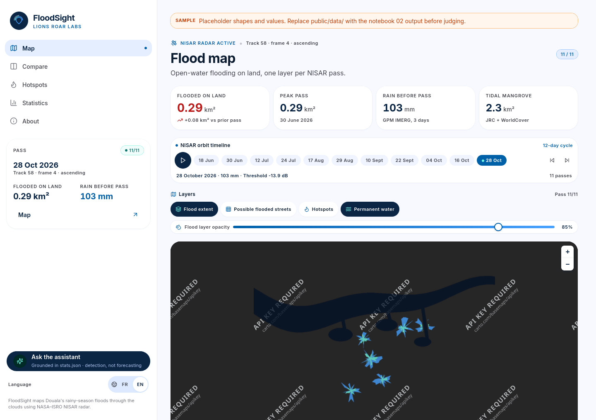

# FloodSight 🌊

**Radar sees floods that cameras can't. FloodSight maps Douala's rainy-season floods through the clouds using NASA–ISRO NISAR.**

*Radar sees the flood. FloodSight shows it, and our AI explains it in your language.*

Lions Roar Labs · NASA Space Apps Challenge 2026 · Challenge: **"Dancing with the SARs"**

| | |
|---|---|
| 🌍 Live app | `TODO: Vercel URL` |
| 🎬 Demo video | `TODO: video link` |
| 📊 Slides | [`docs/pitch/`](docs/pitch/) |



---

## 1. Problem

Douala floods every rainy season (June–October), exactly when clouds block optical satellites. Cameras in space can't see the ground, so floods are hard to map, measure and explain to the people who need to act.

## 2. Solution

FloodSight uses **NISAR L-band radar**, which sees through clouds, day and night. Calm water reflects radar away from the satellite and looks dark; land scatters it back and looks bright. Comparing passes shows where **new water** appeared on land.

The web app shows:

- **Flood map** of Douala for each of the 11 NISAR passes (18 June – 28 October 2026)
- **Before / after slider** to compare two dates
- **Flooded km² per date**, next to rainfall
- **Hotspots**: places that flood again and again
- **Most affected neighbourhoods**
- **Limits panel**: what radar can and can't see
- **FloodSight Assistant** (Gemini): answers in **French or English**, using only FloodSight's own numbers

> FloodSight is a **detection and hotspot-mapping tool, not a forecast.** Forecasting needs rainfall forecasts, drainage models and years of history; it is on the roadmap.

## 3. Impact

| Who | What they get |
|---|---|
| City authorities (CUD, councils) | Where and when it flooded, and which places keep flooding, for drain cleaning and planning |
| NGOs and Red Cross | A free, bilingual map to target help after heavy rain |
| Residents of Douala | A simple FR/EN view on a phone |

## 4. Quickstart (data pipeline, 3 steps)

1. Open `notebooks/FloodSight_01_data_collection.ipynb` in **Google Colab**.
2. Create a free **NASA Earthdata** login (urs.earthdata.nasa.gov) and add `EARTHDATA_USERNAME` and `EARTHDATA_PASSWORD` in Colab **Secrets** (never in code).
3. **Run all**, then run `notebooks/FloodSight_02_flood_detection_v2.ipynb`. Copy the `web_v2/` output into `web/public/data/`.

### Run the web app locally

```bash
cd web
npm install
cp .env.example .env      # add GEMINI_API_KEY (never commit .env)
npm run dev
```

## 5. How it works

```
NISAR GCOV (HH, track 58)  →  dB + speckle filter  →  water mask (Otsu)
        →  flood = water AND ≥ 3 dB darker than the pixel's seasonal normal
        →  remove rivers, tide buffer, mangroves, high/steep ground, patches < 1 ha
        →  PNG layers + stats.json  →  React app + Gemini assistant
```

1. Stack the 11 HH images on one grid, reduce speckle (5-pixel median filter).
2. Each pixel's "normal" level = 75th percentile of its values over the season.
3. Water per date: Otsu threshold, capped between −24 and −14 dB.
4. Permanent water: JRC occurrence ≥ 50 % or water on ≥ 80 % of passes, plus a 60 m shoreline buffer.
5. Exclude mangroves (ESA WorldCover 95) and ground above 20 m or steeper than 5° (Copernicus DEM).
6. **Flood** = water and ≥ 3 dB darker than normal; patches under 1 ha removed.
7. **Possible flooded streets** = built-up pixels ≥ 3 dB *brighter* than normal (double bounce), shown as a separate, less certain layer.
8. **Hotspots** = number of passes each pixel was flooded. **Neighbourhood impact** = flooded km² within 1 km of each OpenStreetMap place.
9. Check against GPM IMERG rainfall and OPERA DSWx-S1 water maps.

## 6. What we found

- NISAR covers Douala well: **11 passes, every 12 days**, with one 24-day gap (24 July – 17 August).
- A first version counted 2–7 km² of "flood" per pass, but most of it was waves, wind, boats and tide in the Wouri estuary.
- After cleaning, **open-water flooding on land is 0.04–0.29 km² per pass**, highest on **30 June** and **28 October**.
- Why so small? Douala's floods are mostly **short urban flash floods** in streets and drains that can drain within hours to a day. A pass every 12 days often misses them. Example: the major flood of **11 September 2026** (Sable, Bonamoussadi) came **one day after** the 10 September pass. See [`docs/reports/flood_reports_douala.csv`](docs/reports/flood_reports_douala.csv).

## 7. Limits and future work

**Limits (also shown in the app)**
- 12-day revisit misses short flash floods.
- Flooded streets turn radar *brighter*, not darker; that layer is less certain.
- Tide and waves near the estuary can look like change; we mask them.

**Future work**
- More seasons of NISAR data → flood **forecasting**
- Add OPERA DSWx-S1 and Sentinel-1 dates to fill the gaps between passes
- Wouri mangroves (vegetation change and flood protection)
- Soil moisture for the Far North (NISAR SME2)
- Mount Cameroon ground deformation (InSAR)
- SMS alerts for residents

## 8. Tech stack (€0)

| Layer | Tools |
|---|---|
| Compute | Google Colab, Kaggle |
| Data access | `asf_search`, `earthaccess`, `pystac-client`, `planetary-computer`, `osmnx` |
| Processing | `h5py`, `xarray`, `rioxarray`, `numpy`, `scipy`, `scikit-image`, `geopandas` |
| Front end | React + Vite + TypeScript, Tailwind CSS, react-leaflet, Recharts, react-i18next |
| AI assistant | `@google/genai`, Gemini Flash (free tier) in a Vercel function (`/api/ask`) |
| Hosting | Vercel (free) |

## 9. Repository

```
├── README.md
├── config/aoi_douala.yaml        # bbox, dates, track, thresholds
├── notebooks/                    # 01 data collection, 02 flood detection v2
├── src/floodsight/               # ingest, preprocess, detect, export
├── web/                          # React app (Vercel)
│   ├── public/data/              # flood PNGs, bounds.json, stats.json
│   └── api/ask.ts                # Gemini assistant
└── docs/
    ├── pitch/                    # slides, demo script, screenshots
    ├── design/                   # UI/UX screens (Stitch)
    └── reports/                  # flood reports from the news (ground truth)
```

## 10. Acknowledgments

NASA Earthdata · ASF DAAC · NASA–ISRO NISAR mission · NASA JPL OPERA project · PO.DAAC · GES DISC (GPM IMERG) · ESA Copernicus (DEM, WorldCover, Sentinel-1) · EC JRC / Google (Global Surface Water) · Microsoft Planetary Computer · OpenStreetMap contributors.

## 11. Team

**Lions Roar Labs** (Douala and Limbe, Cameroon)

| Member | Role |
|---|---|
| Lancelot | Lead, integration, AI assistant |
| `TODO` | Data / science |
| `TODO` | Front end: map |
| `TODO` | Front end: app shell and screens |
| `TODO` | UI/UX, content and pitch |

## Licence

Apache License 2.0, see [LICENSE](LICENSE).
